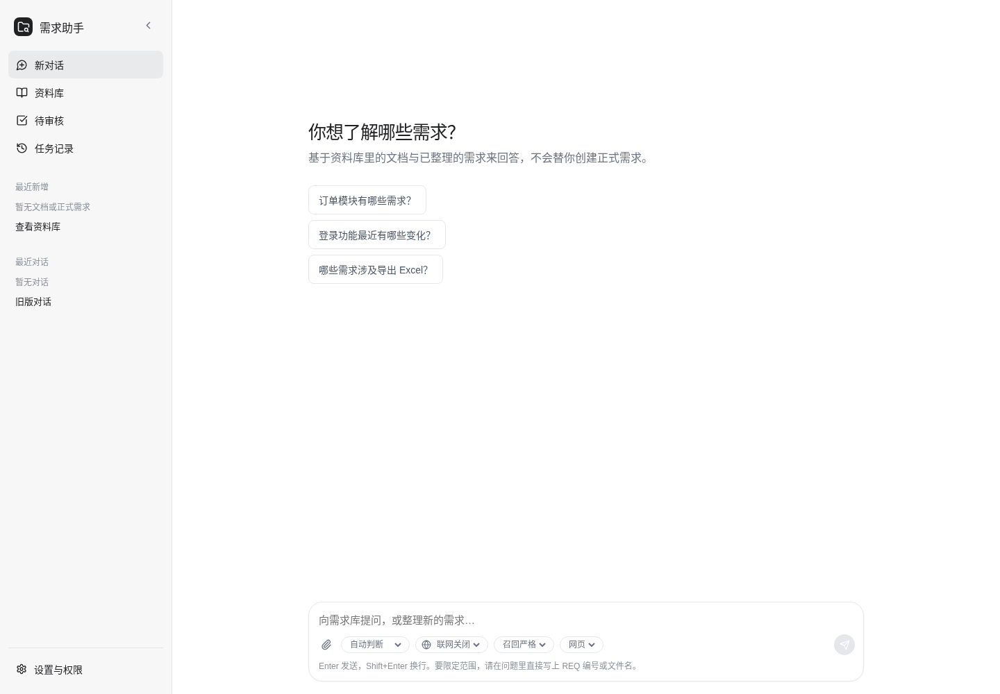

# Requirement Agent

Requirement Agent 是一个面向需求团队的智能工作台，连接文档、需求库、对话和外部研究，将零散信息沉淀为**可检索、可审核、可追溯、可版本化**的需求资产。

平台覆盖“资料接入 → 内容解析与检索 → 需求整理与澄清 → 风险与关系分析 → 合并预演 → 人工审核 → 需求版本与审计”的完整闭环。模型负责提取、分析和辅助问答，正式需求的创建、修改与合并仍由人工审核确认；模型、检索、工具调用、运行状态和版本变更均可追踪。



## 能做什么

- **需求库问答**：在已有需求和文档中检索、回答，并展示实际引用、联网来源和工具调用。
- **文档入库**：上传 PDF、DOCX、Markdown 或文本；查看原始解析分片、Embedding 状态和文档版本链。
- **需求整理**：将自然语言输入整理为候选需求；支持澄清、暂停、恢复、取消和预算耗尽等显式终态。
- **人工审核**：对待审核来源预演合并影响，再批准、拒绝或退回；冲突后必须重新获取详情与预演，不能静默重试。
- **版本与证据**：查看正式需求的功能、Diff、关联来源与版本；历史文档和历史审核记录只读。
- **运行治理**：记录 Agent Run、SSE 事件、模型/工具调用、Outbox 重试与死信，便于排障和审计。

## 工作流

```text
资料 / 文档 / 对话
        │
        ▼
解析、分片、Embedding、检索 ──► 回答与引用
        │
        ▼
需求整理 ──► 澄清 ──► 待审核 ──► 合并预演
                                      │
                                      ▼
                              人工批准 / 拒绝 / 退回
                                      │
                                      ▼
                         正式需求、功能、版本与审计记录
```

## 技术组成

| 层 | 实现 |
| --- | --- |
| API 与运行控制 | Python 3.12+、FastAPI、SSE |
| 数据与向量 | PostgreSQL、pgvector、SQLAlchemy、`vector(4096)` |
| Agent 编排 | LangGraph 风格工作流、Outbox、执行租约与心跳 |
| 模型与检索 | OpenAI 兼容接口 / DeepSeek、独立 Embedding 配置、Hybrid RAG |
| 外部研究 | Tavily MCP（可选，仅通过项目 MCP 适配器） |
| 工作台 | React、TypeScript、Vite、TanStack Query |

## 快速开始

### 前置条件

- Python 3.12+
- PostgreSQL，且已安装 `pgvector` 扩展
- Node.js 20+（构建 React 工作台）
- 可选：DeepSeek/OpenAI 兼容模型、独立 Embedding 服务、Tavily MCP 凭据

### 1. 安装依赖

推荐使用 [uv](https://docs.astral.sh/uv/)：

```bash
uv sync --all-groups
cd frontend && npm ci && npm run build
cd ..
```

或使用 Python 虚拟环境：

```bash
python -m venv .venv
source .venv/bin/activate
pip install -U pip
pip install -e . pytest
cd frontend && npm ci && npm run build
cd ..
```

### 2. 配置环境变量

```bash
cp .env.example .env
```

至少配置 PostgreSQL 和 API 鉴权。所有受保护接口在未配置 token 时默认返回 `401`，不会放行。

```dotenv
POSTGRES_HOST=localhost
POSTGRES_PORT=5432
POSTGRES_DB=requirement_agent
POSTGRES_USER=postgres
POSTGRES_PASSWORD=<your-password>

# 新部署建议使用带角色的 token 映射；不要提交真实 token。
API_AUTH_TOKENS={"<reviewer-token>":"reviewer"}
UI_EXPOSED_TOKEN=<reviewer-token>
```

模型、Embedding、MinIO、飞书和 Tavily 均在 [`.env.example`](.env.example) 中有完整说明。聊天模型和 Embedding 是独立配置：配置了聊天模型不代表向量检索可用。

### 3. 初始化**新建或隔离**数据库

不要把下面的迁移命令指向业务数据库。迁移按编号顺序执行，必须在 API 启动前完成。

```bash
createdb requirement_agent
set -a && . ./.env && set +a

for migration in migrations/*.sql; do
  psql -v ON_ERROR_STOP=1 \
    -h "$POSTGRES_HOST" -p "$POSTGRES_PORT" \
    -U "$POSTGRES_USER" -d "$POSTGRES_DB" \
    -f "$migration"
done
```

> `006_embedding_dimension_4096.sql` 会调整向量维度并删除旧向量索引。升级已有库前请阅读 [migrations/README.md](migrations/README.md)；不要用“跳过失败迁移”代替排查。

### 4. 启动服务

```bash
.venv/bin/python main.py
```

开发时也可使用：

```bash
uv run uvicorn main:app --host 0.0.0.0 --port 8888 --reload
```

打开：

- 工作台：<http://127.0.0.1:8888/app-next>
- 根入口：<http://127.0.0.1:8888/>（重定向到工作台）
- OpenAPI：<http://127.0.0.1:8888/docs>
- 基础健康检查：<http://127.0.0.1:8888/health>

旧静态前端已删除；`/app` 及其子路径会返回 `410 Gone`。

### 5. 可选：独立 Worker

默认 API 进程会消费 Outbox。生产环境可改为独立 Worker：API 进程设为 `false`，Worker 进程设为 `true`（两个进程可使用各自的环境变量覆盖 `.env`）：

```bash
OUTBOX_CONSUMER_ENABLED=false .venv/bin/python main.py

# 另一个终端
OUTBOX_CONSUMER_ENABLED=true .venv/bin/python -m requirement_agent.workers
```

两个消费者同时运行不会重复领取同一事件（使用 `FOR UPDATE SKIP LOCKED`），但通常没有必要。

## 使用工作台

| 页面 | 路由 | 用途 |
| --- | --- | --- |
| 对话 | `/app-next` | 需求库问答、整理需求、联网研究、SSE 运行控制 |
| 资料库 | `/app-next/library` | 文档上传、原始分片、索引状态、文档版本；正式需求检索 |
| 审核列表/详情 | `/app-next/reviews` | 预演、批准、拒绝、退回与冲突处理 |
| 任务列表/详情 | `/app-next/runs` | Run、事件、终态与工具调用记录 |

外部检索默认是“自动”：只有意图被判断为需要外部研究，或用户明确开启联网时，才会调用 Tavily MCP。回答底部显示的来源和工具调用均来自本轮实际结果，不会伪造。

## 外部服务配置

| 能力 | 必要配置 | 验证入口 |
| --- | --- | --- |
| 聊天模型 | `LLM_PROVIDER` 与对应 `*_API_KEY` / `*_BASE_URL` / `*_MODEL` | `GET /api/v1/health/llm` |
| Embedding | `EMBEDDING_BASE_URL`、`EMBEDDING_API_KEY`、`EMBEDDING_MODEL`、`EMBEDDING_DIMENSION=4096` | `GET /api/v1/health/embedding` |
| Tavily MCP | `TAVILY_MCP_ENABLED=true`、`TAVILY_API_KEY` | 对话中开启或自动触发联网研究 |

缺少外部凭据时，相关能力应显示为不可用、失败或降级；不应被解释成“没有检索结果”。请勿在 Issue、终端日志或提交记录中粘贴密钥。

## 测试与质量检查

```bash
# 后端全量回归（需要独立测试数据库和相应环境配置）
.venv/bin/python -m pytest -q

# 前端
cd frontend
npm run test
npm run typecheck
npm run build
```

完整测试边界、已验证流程、外部服务限制与复测命令见 [docs/full_function_test_report.md](docs/full_function_test_report.md)。前端接口与状态契约见 [docs/frontend_api_mapping.md](docs/frontend_api_mapping.md)。

## 项目结构

```text
.
├── frontend/                 # React + TypeScript 工作台（/app-next）
├── src/requirement_agent/
│   ├── api/                  # FastAPI 路由、鉴权与应用入口
│   ├── application/          # 检索、审核、执行控制等应用服务
│   ├── agents/ workflows/    # Agent 与工作流节点
│   ├── infrastructure/       # PostgreSQL、LLM、Embedding、MCP、解析、Outbox
│   ├── tools/                # 内部工具注册与调用
│   └── workers/              # 独立 Outbox Worker
├── migrations/               # 追加式 SQL 迁移
├── tests/                    # 单元与集成测试
├── docs/                     # 方案、接口映射、实施与验收记录
├── main.py                   # 服务入口（默认 :8888）
└── .env.example              # 不含密钥的配置模板
```

## 重要约束

- Snowflake ID 在 JSON、URL 与前端契约中始终使用字符串，不能转为 JavaScript `Number`。
- 未经审核的内容不能写入正式需求；审核冲突（409）必须重新获取详情和预演后才能再次裁决。
- 运行的明确终态包括 `completed`、`failed`、`incomplete`、`paused`、`cancelled`、`waiting_clarification`。
- 文档历史版本与已处理来源均为只读；相同文件内容会去重，不会虚构新版本。

## 文档索引

- [全功能测试报告](docs/full_function_test_report.md)
- [当前前端接口映射](docs/frontend_api_mapping.md)
- [前端实施记录](docs/frontend_refactor_progress.md)
- [Agent 实施记录](docs/agent_refactor_progress.md)
- [数据库迁移说明](migrations/README.md)

---

本仓库当前未声明开源许可证；在复用、分发或部署前，请先确认适用的授权与数据合规要求。
