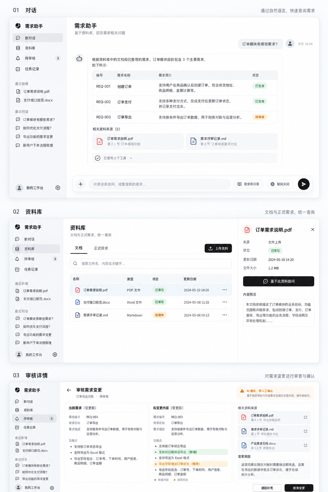
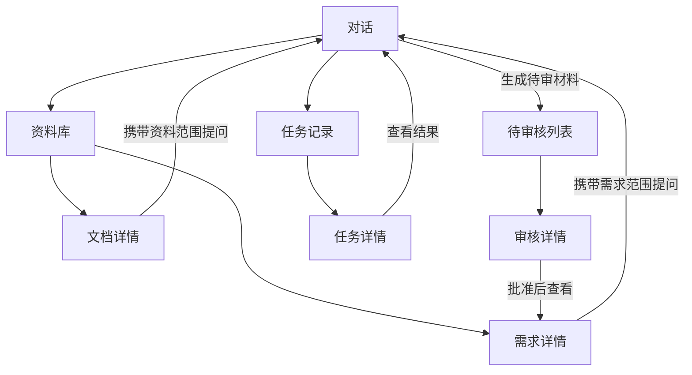

# Requirement Agent 前端重构执行方案

版本：v1.0｜2026-10-10  
面向：终端 Codex｜目标：GPT 风格的需求知识工作台，React + TypeScript 重构

补充工程要求：

1. 在 frontend/ 中初始化 React + TypeScript + Vite。
2. 安装所需依赖：
   - react、react-dom
   - react-router-dom
   - @tanstack/react-query
   - lucide-react
   - 开发依赖：typescript、vite、@vitejs/plugin-react、
     @types/react、@types/react-dom
3. 根据实际需求添加组件、Markdown 与测试依赖，
   不要同时引入多套 UI 组件库。
4. TypeScript 开启 strict；提交 package.json 和锁文件，
   不提交 node_modules。
5. 提供 dev、build、typecheck 脚本，
   完成类型检查与生产构建。
6. CSS 使用统一设计变量，按参考图实现布局与视觉，
   不直接套用默认蓝色后台模板。

## 0. 执行指令与交付边界

用户已确认设计方向，请按本方案实施，不仅提供建议、脚手架或静态占位页。允许按阶段独立提交，但阶段汇报不等于整个任务结束。持续推进至本方案中的页面、交互、验证与记录完成；遇到需要用户提供凭据或决定关键产品行为的真实阻塞时，说明具体阻塞、已完成内容及剩余任务，继续不受影响的工作。

本方案只要求前端重构，以及为页面接入所必需、向后兼容的最小 API 契约补充。不把后端执行器、Proposal 或审批架构重写混入本任务。不自动部署、合并或推送；按用户当前会话授权执行这些操作。

### 参考图的放置

把本文件放入仓库 `docs/frontend_refactor_plan.md`，把本轮已确认的三屏样式图下载并保存为 `docs/design/requirement-workbench-reference.png`。



Codex 应先打开参考图，再读此方案。若图片尚未放入仓库，先按文字完成盘点与接口核对，说明视觉参考缺失；不要声称已对照图片验收。

**优先级：业务正确性 > 本方案的交互规则 > 参考图视觉 > 示例数据。** 参考图不是接口或状态事实源，不照搬图中的日期、编号、数据、品牌图形。尤其图中把待审核条目放进需求结果只是概念示意：实现中必须明确正式需求与草稿身份。不要使用 OpenAI 标志。

## 1. 已确认的产品方向

1. 模仿 GPT 的左侧导航、会话组织、宽松阅读区域、输入框及黑白灰视觉，功能按需求管理组织。
2. **不设项目分栏，不实现多项目数据隔离。** 一套共享资料库；权限继续由现有后端控制。
3. 默认首页是需求库问答，不是要求用户提交新需求。
4. 统一“资料库”入口，内部有“文档”和“正式需求”两个标签。
5. 固定一级入口为：新对话、资料库、待审核、任务记录。
6. 新上传资料、最近入库需求出现在左侧“最近新增”；不为每条新增内容创建一级导航。待审材料由“待审核”入口和计数提示承载。
7. 最近对话放在左侧下方。设置、系统诊断为次级入口。
8. 正式写入继续经过已有人工审核；前端不绕过权限或创造另一套审批。

## 2. 开始前必须盘点的代码

本方案基于此前检查的 `master / 6b767d3`，实施时先确认实际分支与 HEAD，不假设远端或工作区未改变。仓库未提交内容可能包含 Worker/RunTracking 适配草稿，不能覆盖、删除或与前端变更混在同一提交。

重点读取：

- `static/app/*.html`、`static/app/css/app.css`、`static/app/js/core.js`、`shell.js`、`pages/*`。
- `src/requirement_agent/api/app.py`、`auth.py`、`routes/*`、`schemas/*`。
- 聊天 `agent_chat.py`、需求查询、审核与合并预演、文档和运行记录接口。
- `docs/refactoring/frontend-api-mapping.md`、API 契约和现有测试。
- 实际执行服务与 SSE 能力，避免前端声称尚未完成的恢复/后台能力。

既有映射文档包含历史事实，不能直接作为当前接口真相；OpenAPI 对自由 object 响应也不足以完整生成类型。更新一份当前页面→接口→字段→状态→权限映射，记录验证方式与缺口。

优先使用独立分支及必要的 worktree 隔离后端未提交工作。不修改已有用户变更。

## 3. 页面数量、导航与路由

共 **8 个主页面、4 个一级入口**。弹窗、标签与抽屉不重复计数。

建议新应用部署在 `/app-next`，旧 `/app` 保留为回退入口。实际路径如有冲突可调整，但全站只能有一份路由定义。

| # | 页面 | 建议路径 | 主要内容 |
|---|---|---|---|
| 1 | 对话 | `/app-next`、`/app-next/chat/:sessionId` | 新对话、历史、模式、附件、答案、证据 |
| 2 | 资料库 | `/app-next/library?tab=documents` 或 `requirements` | 搜索、筛选、文档/正式需求列表 |
| 3 | 文档详情 | `/app-next/library/documents/:documentId` | 来源、解析索引状态、正文预览、引用定位 |
| 4 | 需求详情 | `/app-next/library/requirements/:requirementKey` | 功能、模块、版本、Diff、来源、关系 |
| 5 | 待审核列表 | `/app-next/reviews` | 待审、历史、筛选 |
| 6 | 审核详情 | `/app-next/reviews/:sourceId` | 原始材料、拟变更、证据、风险、裁决 |
| 7 | 任务记录 | `/app-next/runs` | 对话/分析任务、状态、筛选、分页 |
| 8 | 任务详情 | `/app-next/runs/:runId` | 时间线、工具调用、结果、失败原因、控制 |

详情支持独立 URL 与刷新。列表中可先用抽屉快速预览，同时提供完整详情链接。返回列表恢复搜索条件、标签、页码及必要滚动位置。

### 左侧栏

- 桌面默认 248px，可折叠。顶部产品名“需求助手”、搜索、折叠按钮。
- 固定入口：新对话、资料库、待审核（真实待审数量）、任务记录。
- 最近新增：最多 5 条，区分文档和正式需求，可点开详情。更多内容到资料库查看。
- 最近对话：会话标题、选中态、重命名/删除菜单；长标题省略。
- 底部：设置和权限信息。不虚构当前不存在的登录用户或个人资料。
- 最近新增需使用真实日期排序；若没有统一接口，可合并现有数据，但不能把有限窗口推断为全库最新。待审核数量也不能用截断列表长度冒充总数。

## 4. 页面详细规格

### 4.1 对话

空白页标题“你想了解哪些需求？”，示例：“订单模块有哪些需求？”、“登录功能最近有哪些变化？”、“哪些需求涉及导出 Excel？”。示例点击只填入输入框，由用户发送。

历史与新对话共用同一页面。消息主体宽约 800px，居中。无需常驻右侧工作区，证据、工具过程按点击展开。

输入框：附件、可移除的资料范围标签、任务选择、联网状态、发送/停止。支持 Enter 发送、Shift+Enter 换行及中文输入法组合输入，发送期间防重复提交。附件类型以实际支持为准，不因旧 HTML 有图片 accept 就宣称支持视觉理解。

| 产品名称 | 后端意图/模式 | 规则 |
|---|---|---|
| 需求库问答 | `ask_library` | 首次默认；不擅自创建待审需求 |
| 整理需求 | `draft_requirement` | 明确产出草稿；正式写入仍审核 |
| 联网研究 | `research` | 明确会访问公共网络，受可用性和 web policy 限制 |
| 自动判断 | `auto` | 可作为下拉次级选项，不增加第四个大按钮 |

任务模式与资料范围分开：上传文档不自动等于创建需求。核对文本与 multipart 接口是否都支持 mode/web_policy，缺失时做最小兼容补充；不能只在 UI 改模式却不传后端。

答案按结果类型渲染：正文、小型需求表格、版本差异、澄清问题、草稿卡片、来源卡片。普通回答不使用统一“欢迎/需求模板”。无依据不能填补编号、引用或状态。

来源引用点击打开资料详情或证据面板。已有有效定位展示页码/段落/版本/URL；缺少定位只展示现有信息，不编造页码。打开外部链接使用安全属性。

执行摘要默认折叠：“已查询 3 个工具”。展开显示公开动作、耗时、结果数量、错误；不显示隐含思维链，不把原始工具 payload 全部当聊天内容。

停止生成只在后端确认后展示对应结果；浏览器中止连接与取消服务端任务分别处理。现阶段不承诺断线后继续执行或自动恢复，必须按真实接口能力实现。

从详情“基于此资料提问”进入对话时携带标识范围。若后端暂不支持限定检索，先核对/补最小结构化参数；无法实现则显式说明能力缺口，不能仅把文档名塞进提示词就声称仅查询此文档。

### 4.2 资料库

两个标签共用页头、搜索、筛选区。标签各自保存条件，URL 可恢复。

文档列：名称、类型/来源、解析索引状态、更新时间、更多操作。“上传资料”位于右上方；支持选择、上传状态、成功/失败反馈，成功不等于索引就绪。

正式需求列：编号、标题、所属模块、当前版本、更新时间。模块归属来自真实 Feature 数据；不能从标题推断，也不能在没有列表过滤接口时假装模块筛选有效。

需求变更与新需求材料使用“整理需求”或现有录入接口，并提示待审核。资料文件上传与需求材料提交的语义应在选择时说明，不隐藏两者差别。

当前部分接口只支持 limit，旧前端拉取后本地分页。逐接口核对：支持服务端分页才显示全量 total；只有截断窗口就明确“已加载 N 条”，不得声称全部。必要时追加向后兼容的分页字段与查询参数，补测试。

### 4.3 文档详情

显示名称、来源、解析/索引状态、更新时间、可用正文或分片。按已有能力提供下载/预览/检索，不假设 PDF 页定位、文档版本链都已提供。

主要操作“基于此资料提问”；文档失败给出可理解原因。重建索引属于运维权限操作，放更多菜单，服从后端权限，不使用假按钮。

### 4.4 需求详情

顶部编号、标题、当前版本和最近更新时间。“基于此需求提问”、“提出变更”为主要入口。

标签：功能与模块、版本与差异、来源证据、关联需求。版本号选择后读取真实历史功能，不能混用当前版本数据。Diff 显示新增/修改/删除及前后文本。

关联需求与影响传播不是同一能力；没有影响分析接口就不以关系列表冒充影响范围。回退仅按现有管理员权限提供，明确目标版本及确认，不在普通用户视图突出。

### 4.5 待审核列表

待审与历史两个标签。列：材料标题、来源、建议动作、待处理原因、更新时间。风险只有实际存在才显示，不用伪造置信度排序。

点击进入审核详情；返回时恢复列表。现有审批基于 source_id，不能把它改名为 proposal_id 后假装独立 Proposal 已实现。

### 4.6 审核详情

桌面宽屏三块：现有内容/原始材料、拟变更、来源与风险。中等宽度两块，窄屏顺序堆叠。

新增用淡绿、修改用淡黄、删除用淡红，同时保留文字标记。显示业务对象、功能、来源及合并模式，不把大段 JSON 作为主要展示。

底部固定裁决区。批准前显示真实目标需求、预演变化和可确认的版本信息。合并调用现有 merge-preview 与 ReviewService 入口，预演失败时不得继续把空结果当有效预演。

批准/拒绝/补充动作以实际接口为准。图中“退回补充”若无后端支持，记录缺口、提供可用的处理说明，不实现假状态变化。提交过程禁重复；409 展示状态/版本已改变，重新获取数据，不自动重试裁决。

批准后跳到实际创建/更新的需求及版本。不在前端承诺未实现的 hash 绑定审批。AI 建议与人工裁决分别标记。

### 4.7 任务记录

显示对话与分析任务，明确类型。列：可读任务名、状态、时间、耗时、结果入口。普通页面不显示 token、租约字段或大段异常栈。

筛选依据真实后端能力。数据库 failed + run_incomplete 的组合应映射为“未完成/预算耗尽”，保留原始状态供诊断，不当作普通成功。

### 4.8 任务详情

公开动作时间线、工具与模型调用摘要、已有结果、失败/降级原因。技术详情可展开。

暂停、取消、恢复、重试只有接口支持且状态允许时展示。失败给出明确提示，不做乐观终态；模型调用是否从独立 ops 接口获取要按权限处理。

当前部分事件仅结束后可见：有轮询就展示“最近更新”，没有实时订阅不要伪造百分比或模拟步骤。后续 SSE 接通后替换数据通道，无需重做整个页面。

## 5. 页面联系与上下文



核心场景：找需求→看功能→查来源→比较版本；资料→限定范围问答；对话草稿→审核→正式版本；失败回答→对应任务→原因。所有跳转携带真实标识，不复制原文冒充关联。

## 6. 视觉规范

参考图中的外部“01/02/03”标题不属于产品界面；不要把整张图片用作页面背景，也不要简单截屏切图实现 UI。

| 项目 | 初始规范 |
|---|---|
| 主背景 | `#FFFFFF` 或接近白色 |
| 侧栏/弱背景 | `#F7F7F8` |
| 主文字 | `#202123` |
| 次文字 | `#6B7280`，校验对比度 |
| 边框 | `#E5E7EB` |
| 主操作 | 黑底白字；选中导航浅灰 |
| 状态色 | 仅成功、警示、失败与 Diff 使用绿/黄/红 |
| 圆角 | 输入区 20～24px，卡片 12px，控件 8px |
| 间距 | 4/8/12/16/24/32px |
| 字体 | 系统字体与中文 sans-serif；正文 14～16px，页标题 22～26px |
| 图标 | 一套线性 SVG 图标，禁混用 emoji/文字符号 |
| 动效 | 简短淡入/展开；尊重 reduced-motion |

避免大渐变、玻璃背景、满屏统计卡片、粗阴影、彩色胶囊泛滥和蓝色后台模板。对话重阅读，列表重扫描，审核重对比。

响应式验证：1440、1280、768、390px。桌面侧栏固定，窄屏变抽屉；对话不横向溢出，详情证据面板可独立收起。表格在窄屏保留核心信息或切换条目列表，而不是整页横向滚动。

可访问性：可见 focus、键盘导航、弹窗焦点管理、关闭后焦点恢复、状态不只靠颜色、按钮有名称，流式消息更新不应反复朗读整段历史。

## 7. 技术实施约束

采用 React + TypeScript（strict）+ Vite、React Router、TanStack Query。图标使用单一方案如 Lucide。基础控件可选一套兼容设计的组件方案；避免同时引入多套重型 UI 库。不要为每个字段建立全局 store，服务端数据由 Query 管理，局部交互由组件状态管理。

推荐结构：

```text
frontend/
  src/
    app/                 # router、providers、AppShell
    features/
      chat/
      library/
      documents/
      requirements/
      reviews/
      runs/
    components/          # Button、Dialog、Drawer、StateView 等
    contracts/           # 请求响应类型、关键边界校验
    lib/                 # HTTP、SSE、格式化、错误处理
    styles/              # 单一设计 token 与基础样式
```

重要约束：

- API 统一经 client，ID 全程字符串；时间明确时区；字段缺失显示未提供，不伪造 0/空集合意义。
- 按状态码处理 401/403/404/409/422/5xx，展示 request_id；不依赖中文错误全文分支。
- 读请求取消与写操作取消分开；批准、删除、回退不自动重试，不乐观宣称完成。
- 聊天是 POST SSE 且带 Authorization，使用 fetch + ReadableStream；不能直接换原生 EventSource。
- SSE 处理跨 chunk、CRLF、多个 data 行、尾块、done/error、断流及卸载清理；缓存 key 区分 session/run。
- 没有 last-event-id/sequence 回放契约前，不声称去重恢复完整。已有客户端幂等 ID 保留。
- Markdown 默认禁止原始 HTML，外链安全，不能使用不受控 dangerouslySetInnerHTML。
- 不把 token 写入 `VITE_*`、构建文件或源码；沿用已确认运行时凭证方式，核对角色范围，不扩大权限。生产身份改造另行处理。
- 保留 CSP 等安全头；组件与样式必须实际验证兼容，不用关闭 CSP/SSL 解决报错。
- Vite 开发代理同源 API；生产由 FastAPI 服务 dist，配置正确 base/assets 路径与 SPA 深链接。不能用未校验 URL 拼磁盘路径。
- 老 `/app` 保留；新旧不会同时启动重复任务。旧状态、接口、审核行为保持兼容。

## 8. 实施阶段与退出条件

这些阶段是连续任务，不是每做完一阶段就结束或等用户重复催促。每阶段记录实际成果并独立提交，不提交密钥、业务数据、依赖缓存或无关后端草稿。遇到接口缺口先查真实实现、补最小契约或记录明确阻塞，不能以大量占位页宣布完成。

| 阶段 | 交付 | 完成条件 |
|---|---|---|
| F0 | 代码/接口盘点与迁移清单 | 8 页字段、权限、状态、缺口均有依据 |
| F1 | 工程、设计系统、路由、AppShell、HTTP/SSE 层 | 构建可运行，旧入口保留，深链接和凭证可用 |
| F2 | 资料库、文档详情、需求详情 | 真实查询、筛选、预览、来源、版本 Diff 可用 |
| F3 | 对话页面 | 模式、附件、会话、证据、错误与取消按真实能力接通 |
| F4 | 审核列表与详情 | 预演、裁决、权限、409 刷新、批准后跳转通过验证 |
| F5 | 任务列表与详情 | 真实时间线、结果、状态和可用控制；无假实时 |
| F6 | 视觉/交互/集成验收 | 8 页完成，截图、测试、说明与回退记录齐全 |

后端执行器统一可与前端并行推进；与其冲突的文件先隔离，不为做前端重写 Worker。任务持久恢复、实时 SSE、独立 Proposal、审批 hash 绑定仍属于后端后续能力，前端不作虚假声明。

## 9. 验证与验收

使用隔离数据，不在业务库批准、删除、回退真实需求。样例只放测试/显式演示模式，正常页面不能静默 fallback 到 mock。

必验用户场景：

1. 新对话询问某模块需求→打开需求→查看功能和来源→返回原对话。
2. 文档上传→状态更新→打开预览→基于文档提问；解析失败有明确反馈。
3. 模式切换正确传参；联网未配置显示不可用；问答不创建正式需求。
4. 需求版本比较正确展示新增/修改/删除；来源跳转保留定位。
5. 待审材料→真实预演→测试库批准→对应需求版本；重复提交/409 不创建额外结果。
6. 执行中取消、预算耗尽、工具错误分别展示；任务详情状态与后端一致。
7. 浏览器刷新与前进后退恢复 URL；流结束、换会话、页面卸载无遗留读取任务。
8. 长标题、长答案、大表格、无数据、无权限、网络失败和窄屏可用。

自动验证按变更选择：TypeScript 检查、生产构建、SSE 解析/状态映射单元测试、关键端到端流程。不要写镜像实现的无价值测试。需要的后端契约补充执行相关测试。

视觉验收必须实际渲染：提供对话、资料库、审核详情三页桌面截图，以及至少一张窄屏截图；与参考图对照导航、留白、阅读宽度、配色和密度。不能只看源码说好看。

最终交付清单：

- 可运行的 React 前端和部署接入，8 页与真实接口联通。
- `docs/frontend_refactor_progress.md`：每阶段状态、提交、测试、截图、限制。
- 当前接口映射及任何最小后端补充的说明。
- 启动、构建、访问 `/app-next` 和回退 `/app` 的说明。
- 实际验证结果，区分 mock 测试、隔离数据库和真实服务联调。
- 未完成/阻塞事项逐条列出；不得用“整体完成”掩盖占位页或未接入按钮。

## 10. 给终端 Codex 的启动提示

```text
请读取 docs/frontend_refactor_plan.md，并打开
docs/design/requirement-workbench-reference.png。

我已确认这版设计：GPT 黑白灰风格、不做项目分栏；
4 个一级入口、8 个主页面；资料库统一文档与正式需求。
请在隔离前端分支按 F0～F6 连续实施，按阶段独立提交。
先确认当前代码和接口，保护已有未提交的后端改动。
不要只搭脚手架、画静态页或生成待办后结束。
正常页面接真实数据，审批复用现有服务，缺失能力如实说明。
图片是视觉参考，业务行为按方案和真实接口。
实施中可阶段汇报，但继续完成到验收；仅真实外部阻塞才暂停。
最终给出运行方法、实际页面截图、测试结果、提交及未完成项。
```
